# V01 — FastAPI + OpenAI

**Problema:** Responder preguntas sobre incidentes con salida estructurada.

## Arquitectura



> Fuente editable: [diagrama.mmd](diagrama.mmd) (regenerar con `scripts/render_diagrams.sh`).


## Archivos principales

app/api/routes/diagnose.py, app/llm/{base,mock_provider,openai_provider,factory}.py, app/services/diagnosis.py, app/models.py

## Cómo probar (modo mock, sin red)

```bash
.venv/bin/python -m pytest tests/unit/test_v01_diagnose.py -v
```

## Aceptación

Respuesta estructurada, proveedor intercambiable (mock/OpenAI), fallos del LLM → 503 sin filtrar detalles, sin secretos en código.

## Riesgos / pendientes

- Datos y valores sintéticos; no son límites de seguridad industrial.
- Modo real (OpenAI / Supabase / AWS) requiere configuración en `.env.example`; no verificado en este README.
