# V04 — LangGraph + memoria

**Problema:** Diagnóstico iterativo con continuidad entre solicitudes.

## Arquitectura



> Fuente editable: [diagrama.mmd](diagrama.mmd) (regenerar con `scripts/render_diagrams.sh`).


## Archivos principales

app/agents/{graph,nodes,state,context}.py, app/memory/gateway.py, app/store/

## Cómo probar (modo mock, sin red)

```bash
.venv/bin/python -m pytest tests/unit/test_v04_graph.py -v
```

## Aceptación

INC-204 se reanuda, `max_steps` corta bucles, hipótesis nunca se convierten en observaciones.

## Riesgos / pendientes

- Datos y valores sintéticos; no son límites de seguridad industrial.
- Modo real (OpenAI / Supabase / AWS) requiere configuración en `.env.example`; no verificado en este README.
