# V05 — Lambda vs. EC2

**Problema:** Mismo runtime en dos destinos de despliegue.

## Arquitectura



> Fuente editable: [diagrama.mmd](diagrama.mmd) (regenerar con `scripts/render_diagrams.sh`).


## Archivos principales

handlers/lambda_api.py, Dockerfile.lambda, Dockerfile.ec2, docker-compose.yml, app/api/routes/diagnose.py (/quick, /extended)

## Cómo probar (modo mock, sin red)

```bash
.venv/bin/python -m pytest tests/integration/test_v05_runtime_parity.py -v
```

## Aceptación

Paridad Lambda/EC2 sobre el mismo núcleo. La comparación de costos/limitaciones está en `docs/architecture/lambda-vs-ec2.md`.

## Riesgos / pendientes

- Datos y valores sintéticos; no son límites de seguridad industrial.
- Modo real (OpenAI / Supabase / AWS) requiere configuración en `.env.example`; no verificado en este README.
