# V06 — Trust boundaries / prompt injection

**Problema:** Texto en documentos recuperados es no confiable.

## Arquitectura



> Fuente editable: [diagrama.mmd](diagrama.mmd) (regenerar con `scripts/render_diagrams.sh`).


## Archivos principales

app/mcp/tool_gateway.py, app/governance/policies.py, app/agents/nodes.py

## Cómo probar (modo mock, sin red)

```bash
.venv/bin/python -m pytest tests/security/test_v06_prompt_injection.py -v
```

## Aceptación

La defensa vive en el gateway y la política, no solo en el prompt.

## Riesgos / pendientes

- Datos y valores sintéticos; no son límites de seguridad industrial.
- Modo real (OpenAI / Supabase / AWS) requiere configuración en `.env.example`; no verificado en este README.
