# V08 — Secrets Manager + MCP seguro

**Problema:** Sin credenciales en repo, logs ni trazas.

## Arquitectura



> Fuente editable: [diagrama.mmd](diagrama.mmd) (regenerar con `scripts/render_diagrams.sh`).


## Archivos principales

app/security/{secrets,redaction}.py, docs/threat-model/iam-policies.md, scripts/seed_app_secret.py

## Cómo probar (modo mock, sin red)

```bash
.venv/bin/python -m pytest tests/security/test_v08_secrets_and_mcp.py -v
```

## Aceptación

Sin credenciales en el repo, logs redactados, MCP rechaza llamadas sin firma o fuera de allowlist, IAM sin wildcards de acciones.

## Riesgos / pendientes

- Datos y valores sintéticos; no son límites de seguridad industrial.
- Modo real (OpenAI / Supabase / AWS) requiere configuración en `.env.example`; no verificado en este README.
