# V09 — Memoria segura + acciones aprobadas

**Problema:** Órdenes de trabajo requieren aprobación humana e idempotencia.

## Arquitectura



> Fuente editable: [diagrama.mmd](diagrama.mmd) (regenerar con `scripts/render_diagrams.sh`).


## Archivos principales

app/actions/*, app/governance/approvals.py, app/api/routes/approvals.py

## Cómo probar (modo mock, sin red)

```bash
.venv/bin/python -m pytest tests/security/test_v09_actions.py -v
```

## Aceptación

Sin aprobación no se ejecuta nada; replay, auto-aprobación, parámetros alterados y duplicados en cola son rechazados.

## Riesgos / pendientes

- Datos y valores sintéticos; no son límites de seguridad industrial.
- Modo real (OpenAI / Supabase / AWS) requiere configuración en `.env.example`; no verificado en este README.
