# V10 — Security CI

**Problema:** El pipeline debe bloquear regresiones de seguridad.

## Arquitectura



> Fuente editable: [diagrama.mmd](diagrama.mmd) (regenerar con `scripts/render_diagrams.sh`).


## Archivos principales

.github/workflows/ci.yml, tests/security/

## Cómo probar (modo mock, sin red)

```bash
.venv/bin/python -m pytest tests/security/test_v10_security_ci.py -v
```

## Aceptación

Un bug de aislamiento inducido hace fallar la suite; al repararlo vuelve a pasar.

## Riesgos / pendientes

- Datos y valores sintéticos; no son límites de seguridad industrial.
- Modo real (OpenAI / Supabase / AWS) requiere configuración en `.env.example`; no verificado en este README.
