# V12 — Evaluación golden/adversarial

**Problema:** Medir calidad de forma reproducible.

## Arquitectura



> Fuente editable: [diagrama.mmd](diagrama.mmd) (regenerar con `scripts/render_diagrams.sh`).


## Archivos principales

app/evaluation/runner.py, scripts/{generate_eval_cases,run_eval}.py, data/evaluations/

## Cómo probar (modo mock, sin red)

```bash
.venv/bin/python -m pytest tests/evaluation/test_v12_eval.py -v
```

## Aceptación

Última ejecución (`evaluation_report.json`): golden 25/25, adversariales 10/10 bloqueados, citas y herramientas 100 %, p95 ≈ 44 ms, costo estimado ≈ US$0.0057 (estimación con tokens mock).

## Riesgos / pendientes

- Datos y valores sintéticos; no son límites de seguridad industrial.
- Modo real (OpenAI / Supabase / AWS) requiere configuración en `.env.example`; no verificado en este README.
