# V13 — Observabilidad y auditoría

**Problema:** Rastrear un diagnóstico de punta a punta.

## Arquitectura



> Fuente editable: [diagrama.mmd](diagrama.mmd) (regenerar con `scripts/render_diagrams.sh`).


## Archivos principales

app/observability/telemetry.py, app/governance/audit.py

## Cómo probar (modo mock, sin red)

```bash
.venv/bin/python -m pytest tests/unit/test_v13_observability.py -v
```

## Aceptación

IDs correlacionados, redacción de secretos/PII, denegaciones auditadas, OTel apagado salvo configuración.

## Riesgos / pendientes

- Datos y valores sintéticos; no son límites de seguridad industrial.
- Modo real (OpenAI / Supabase / AWS) requiere configuración en `.env.example`; no verificado en este README.
