# V14 — Terraform + CI/CD + Docker + ECR

**Problema:** Despliegue reproducible sin drift.

## Arquitectura

> Fuente editable: [diagrama.mmd](diagrama.mmd) (regenerar con `scripts/render_diagrams.sh`).

## Archivos principales

infrastructure/terraform/{bootstrap,modules,environments}, .github/workflows/{ci,deploy,terraform-apply}.yml, scripts/smoke_test.py

## Cómo probar (modo mock, sin red)

ninguno automático (requiere AWS); validar con `terraform fmt -check && terraform validate`

## Aceptación

OIDC sin access keys estáticas; `terraform apply` solo con aprobación; Terraform es dueño de la infraestructura y el pipeline de la versión de imagen. **No se ejecutó ningún despliegue real.**

## Riesgos / pendientes

- Datos y valores sintéticos; no son límites de seguridad industrial.
- Modo real (OpenAI / Supabase / AWS) requiere configuración en `.env.example`; no verificado en este README.
